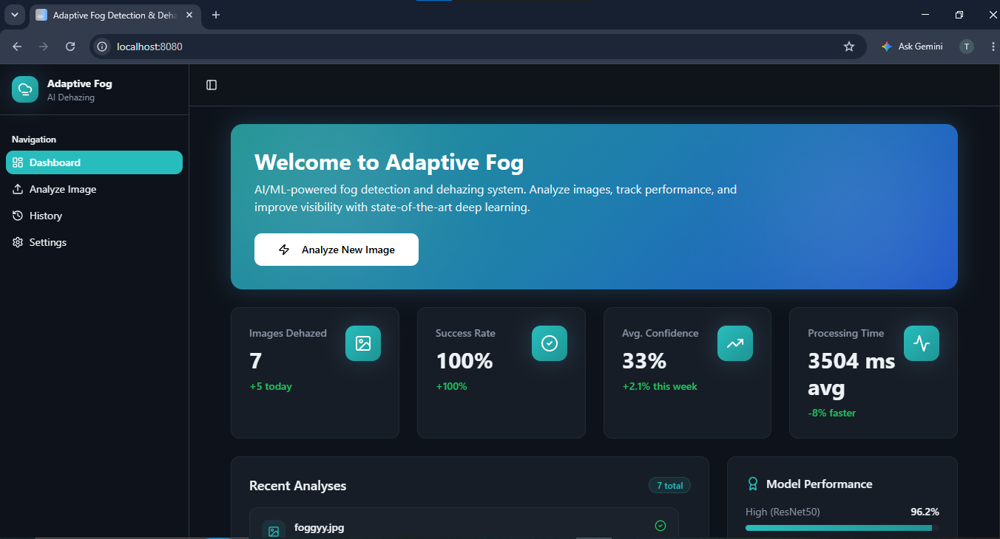
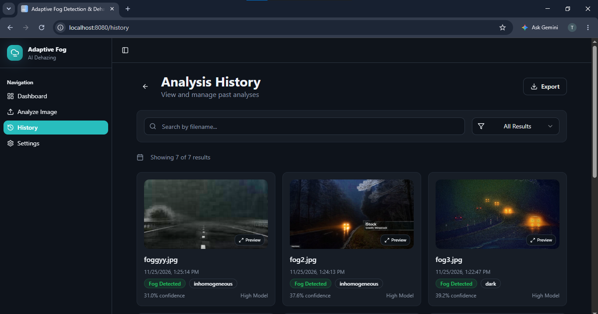
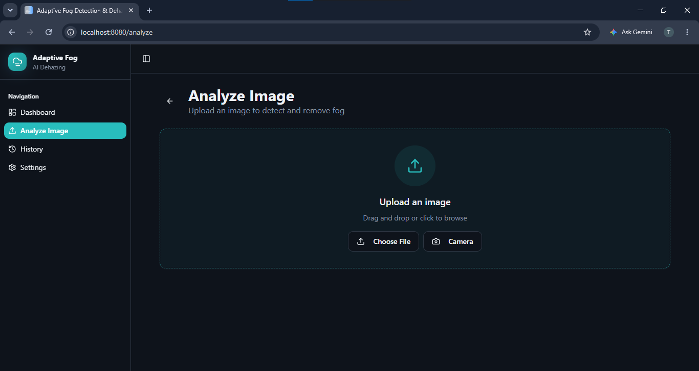
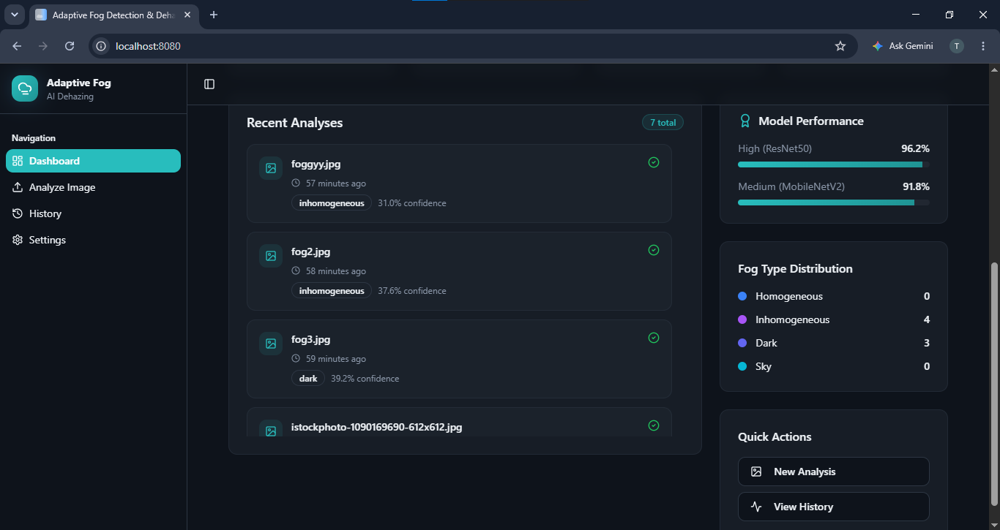
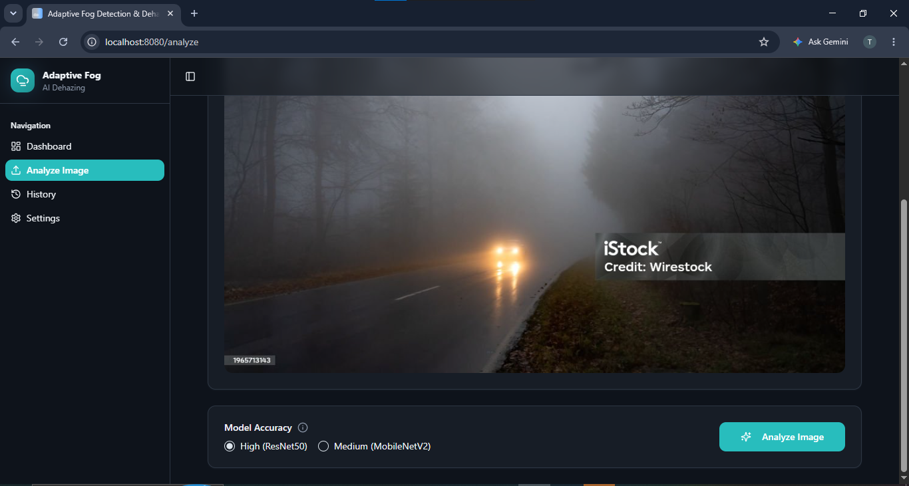
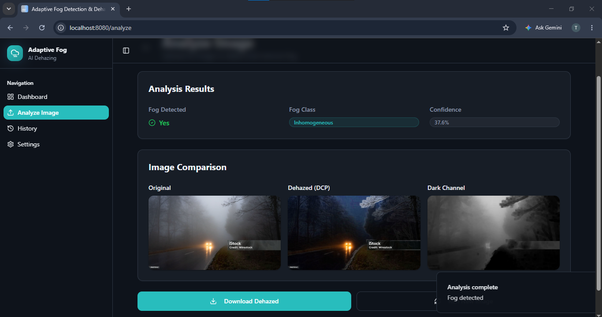
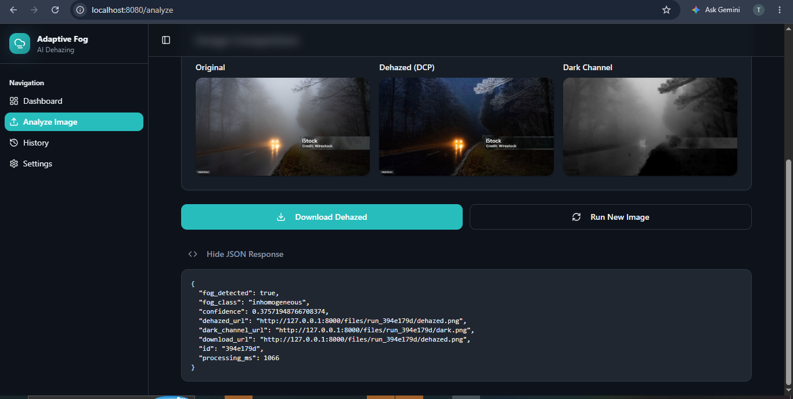

# Fog Detection and Dehazing

A web app that detects fog in an image and removes it. Upload a photo and the app classifies the fog level, then returns a dehazed image and the dark channel map.

## Screenshots

| | |
|---|---|
|  |  |
|  |  |
|  |  |
|  | |

## How it works

1. A PyTorch model classifies the fog level of the uploaded image (`high` or `medium` model variant).
2. If fog is detected, the image is dehazed with the Dark Channel Prior method (OpenCV + NumPy).
3. The API returns the dehazed image, the dark channel map, the fog class, the confidence and the processing time.

## Tech stack

**Frontend:** Vite, React, TypeScript, Tailwind CSS, shadcn-ui

**Backend:** Python 3.11, FastAPI, Uvicorn, PyTorch, torchvision, OpenCV, NumPy, Pillow

## Project structure

```
.
├── BACKEND/
│   ├── app/
│   │   ├── main.py         # FastAPI app and endpoints
│   │   ├── models.py       # model loading and fog classification
│   │   ├── dehaze.py       # Dark Channel Prior dehazing
│   │   ├── analytics.py    # usage logging and stats
│   │   ├── utils.py
│   │   └── config.py       # settings and environment variables
│   ├── models/             # class_names.json and model weights (.pt)
│   ├── files/              # generated output images and analytics log
│   └── requirements.txt
├── FRONTEND/
│   ├── public/
│   ├── src/                # components, hooks, pages, services, types
│   ├── .env.example
│   └── package.json
├── screenshots/
├── LICENSE
└── README.md
```

## Run locally

### Backend

```bash
cd BACKEND
python -m venv .venv
.venv\Scripts\activate          # Windows
# source .venv/bin/activate     # Mac/Linux
pip install -r requirements.txt
uvicorn app.main:app --port 8000 --reload
```

Check it at `http://localhost:8000/health`. API docs are at `http://localhost:8000/docs`.

**Model weights:** place the trained `.pt` files in `BACKEND/models/`. They are not included in the repo.

### Frontend

```bash
cd FRONTEND
copy .env.example .env          # Windows (use cp on Mac/Linux)
npm i
npm run dev
```

Open the URL it prints. The `.env` file holds the backend URL:

```
VITE_API_BASE_URL=http://127.0.0.1:8000
```

## API

| Method | Endpoint | Description |
|---|---|---|
| GET | `/health` | Health check |
| POST | `/api/infer` | Upload an image (`file`) and choose `variant` (`high` or `medium`) |
| GET | `/api/stats` | Usage statistics |
| GET | `/api/recent?limit=20` | Most recent runs |
| GET | `/files/...` | Output images |

## Backend environment variables

| Variable | Default | Purpose |
|---|---|---|
| `HOST` | `0.0.0.0` | Server host |
| `PORT` | `8000` | Server port |
| `MODELS_DIR` | `./models` | Model weights folder |
| `FILES_DIR` | `./files` | Output images folder |
| `CORS_ALLOW_ORIGINS` | `*` | Comma-separated allowed origins |

## Deployment

- **Frontend:** Vercel (preset: Vite, root directory: `FRONTEND`, build: `npm run build`, output: `dist`). Set the environment variable `VITE_API_BASE_URL` to your deployed backend URL (no trailing slash), then redeploy.
- **Backend:** needs a host that runs Docker containers with enough RAM for PyTorch (at least 2 GB). It cannot run on Vercel because of PyTorch's size and the local file storage.

## License

See [LICENSE](LICENSE).